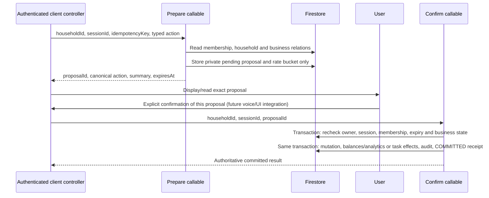

# Jarvis confirmed actions (backend phase)

This phase implements four Firebase callables in `europe-west1`. Existing React
expense review, task confirmation, voice input and Realtime tools remain in place.
The new APIs are not yet connected to voice or the React confirmation UI. No
Python companion or cloud Notes migration is included in this phase.

## Architecture and trust boundary



A model can suggest action data but cannot approve a proposal. None of these APIs
has been added to the OpenAI tool list. Future clients must handle explicit user
confirmation in a deterministic controller and must announce success only after
`COMMITTED`. Session IDs bind client context; they are not additional identity
credentials. Voice is a convenience input, not identity verification. An
unauthorized client with a stolen Firebase token remains a compromised session.

All callables use `secureCallable`: Firebase Auth, verified email, strict Zod
input validation and the existing `ENFORCE_APP_CHECK` policy. Membership is read
inside each transaction, including retries and status reads. Household members
have the same financial/task permissions as the existing mutation APIs. Clients
cannot supply actor identity, expense owner, source, bank IDs or audit authority.
Expense ownership is resolved from the actual selected account. No account is
inferred from an amount, description, household default, or model response.

## Contracts

Contracts and response types live in `packages/shared/src/schemas/jarvis-actions.ts`.
Unknown object fields are rejected, including nested task recurrence fields. All
IDs used in paths exclude slashes. Amounts must be positive safe integers in minor
units; currency must match both the active account and the household reporting currency,
preserving the existing account/form/Jarvis restriction. Dates are ISO instants for expenses
and valid household-local dates/times for tasks. Task payloads reuse existing
validation; CREATE_TASK starts in TODO state. Tags and expense timestamps are
canonicalized by the server.

`jarvisPrepareAction` input:

```json
{
  "householdId": "your-authorized-household",
  "sessionId": "8524df5e-8bd5-4d9f-b23a-14df8fc15fc5",
  "idempotencyKey": "b3966249-ea20-476c-b2e2-1f151b6b675e",
  "action": {
    "type": "CREATE_EXPENSE",
    "payload": {
      "accountId": "actual-account-id",
      "categoryId": "actual-expense-category-id",
      "amountMinor": 2800,
      "currency": "EUR",
      "description": "Fuel",
      "transactionDate": "2026-10-19T09:00:00.000Z"
    }
  }
}
```

Supported discriminators and payloads:

| Type              | Payload                                                                                                                                                         |
| ----------------- | --------------------------------------------------------------------------------------------------------------------------------------------------------------- |
| `CREATE_EXPENSE`  | Required accountId, categoryId, amountMinor, currency, description, transactionDate; optional merchant, notes, tags. No splits in this phase.                   |
| `CREATE_TASK`     | Existing task core fields, strictly validated; title required; optional dates, assignee, list, reminders, recurrence and related transaction. TODO status only. |
| `COMPLETE_TASK`   | taskId and required expectedVersion.                                                                                                                            |
| `RESCHEDULE_TASK` | taskId, required expectedVersion, dueDate, dueTime (HH:mm or null for all day). Other task fields are preserved.                                                |

`CREATE_NOTE` can be added as a new discriminated-union member with its own
validation and business mutation plan. Unsupported types currently fail closed.

Prepare returns `JarvisActionProposal`: proposalId (64 hexadecimal characters),
householdId, sessionId, canonical action, human-readable English summary, status,
createdAt/expiresAt (ISO strings), result (null until committed). Clients can
localize the preview using the typed canonical action. Expense summaries include
amount, currency, actual account/category names and date in household time zone.
Task summaries include title, schedule and applicable assignee/list/recurrence.

All three resolution APIs take **only**:

```json
{
  "householdId": "your-authorized-household",
  "sessionId": "8524df5e-8bd5-4d9f-b23a-14df8fc15fc5",
  "proposalId": "64-character-id-returned-by-prepare"
}
```

- `jarvisConfirmAction` returns the committed proposal with
  `result: { entityId, nextTaskId? }`. It rejects cancelled/expired proposals.
- `jarvisCancelAction` returns the authoritative terminal state. Cancellation of
  an already committed proposal returns COMMITTED; it cannot undo a mutation.
- `jarvisActionStatus` returns the current proposal and lazily records expiration.
  Use it after an uncertain network response before presenting success or retrying.

Typical error codes: `unauthenticated`, `failed-precondition` (unverified email,
expired/cancelled proposal or changed business conditions), `permission-denied`
(user/household/session mismatch or removed member), `invalid-argument`,
`not-found`, `already-exists` (conflicting retry key or occupied target entity),
`aborted` (stale task version), `resource-exhausted` (preparation rate).
Do not automatically replace a stale/expired proposal and confirm it. Show a
fresh preview and obtain a fresh explicit user confirmation.

## Lifecycle, retries and atomicity

```text
PENDING --confirm--> COMMITTED
        --cancel---> CANCELLED
        --timeout--> EXPIRED
```

Pending proposals last 120 seconds. Terminal states never revive. Confirm,
cancel and expiry contend on the same proposal document. A repeated successful
confirmation returns its original result, even after the original expiry time.
This also handles a successful commit whose HTTP response was lost. Business
relations, displayed names, account ownership/currency/category, household time
zone and task versions are checked again. Changed proposal details require a
fresh review. Balance changes alone do not invalidate an expense.

A SHA-256 ID derived from authenticated UID and UUID idempotency key identifies a
proposal. The stored request fingerprint covers the validated request, including
household and session. Identical retries return the same proposal; conflicting
reuse fails. Keep the same key and session for retries; use a new UUID only for a
new intended action. Canonical payload/context fingerprints detect changes
between preview and execution. They are integrity comparisons, not secrets or
user authentication tokens.

`planTransactionCreation`, `planTaskCreation`, `planTaskCompletion` and
`planTaskUpdate` reuse the existing domain implementations. They read/validate and
return a commit closure. Preparing a proposal never invokes that closure. The
ordinary transaction/task callables also use these plans. Confirmation invokes
the plan inside the same Firestore transaction that writes the result receipt.
There are no nested transactions, external calls or notifications sent directly
from transaction callbacks. Existing task notifications are persisted for the
existing delivery workers; recurrence and financial audits retain their existing
semantics. Firestore requires all reads before writes and retries conflicting
transactions ([official transaction documentation](https://firebase.google.com/docs/firestore/manage-data/transactions)).

Preparation persists only private protocol metadata and a quota record. It does
not write transactions, account balances, analytics, tasks, activity,
notifications or business audit events. Domain audits are written on commit,
using the existing audit actions, with the authenticated actor and entity ID.

## Storage, privacy and cost controls

- `privateJarvisActions/{proposalId}` stores the UID, household/session/key,
  canonical bounded action, fingerprints, summary, status, timestamps and result.
- `privateJarvisActionLimits/{hashedUid}` bounds new proposals to 20 per minute
  per user across sessions and households. Identical prepare retries do not use
  another slot. Payload arrays and strings have fixed schema limits. Each request
  reads a bounded set of referenced documents; no unbounded scans are used.
- Firestore rules deny every direct client read/query/write to both collections.
  Admin Functions exclusively manage them. No special indexes or paid resources
  need provisioning for this phase. Tests use demo emulator projects only.
- No raw audio, tokens, prompts or action payloads are logged by this service.
  Existing business audit policies still apply to committed records.
- Expiration is enforced logically, without relying on delayed Firestore TTL.
  There is deliberately **no TTL deletion** of receipts: removing the retry-key
  record would allow a previously used key to create a second action. Receipts
  currently retain bounded personal payloads indefinitely. A later retention job
  may redact payload/summary after resolution while preserving permanent UID/key,
  fingerprint/status/result tombstones and compatibility with retry/status APIs.
  Do not enable TTL on expiresAt. Storage growth and per-user quota tuning remain
  operational considerations; global quotas and detailed telemetry are later work.

## Testing and manual QA

Use the repository's installed Node dependencies and Java 21. Node 22 is the
Functions runtime; current local checks may run on Node 24 if that is the selected
host version. Test output must identify any runtime mismatch.

```bash
npm run typecheck
npm run lint
npm test
npm run test:jarvis-actions
npm run test:rules
npm run test:e2e
npm run build
```

CI runs a dedicated Jarvis transactional job with Node 22 and Java 21, alongside
the existing verification and rules jobs.

The dedicated action suite fails closed unless FIRESTORE_EMULATOR_HOST is
loopback and GCLOUD_PROJECT begins with demo-. Without an emulator, the suite is
explicitly skipped by ordinary workspace unit tests. It uses actual Firestore
transactions for confirmation races, cancel races, retries, expiry, authorization,
financial effects, audits, recurrence and staleness. Its timeout allows emulator
contention backoff; timeout failures must never be counted as passing races.
No OpenAI calls, production data or real notification deliveries are required.

For manual QA against emulators, use a verified test user and actual seeded
account/category IDs. Call prepare with a UUID session/key and display its result.
Confirm that only the two private protocol collections change. Confirm twice and
check a single financial/task entity, correct balances/analytics and one mutation
audit. Retry with another user/session, remove membership, expire or cancel a
proposal, and change a task version; each must fail without a business write.
Race confirm/cancel and inspect status rather than assuming cancellation won.
Repeat the existing transaction form and recurring-task UI workflows. Browser
voice confirmation is not part of this backend QA or this phase's completion.

## Rollback and troubleshooting

This is additive storage with no migration of existing financial, task or Notes
data. No production deployment is performed by this work. A future authorized
release should ship the explicit deny rules before exposing new clients, retain
App Check enforcement as configured, and validate the four callables in
`europe-west1`. Desktop production enrollment/App Check remains unimplemented;
do not disable enforcement to connect a desktop client.

If rolling back a future release, disable clients using these APIs, restore the
previous Functions code, retain the private deny rules and all receipts. Do not
replay proposal payloads through ordinary creation APIs, delete receipts or alter
committed records. Rollback does not undo confirmed transactions/tasks; corrections
must use the application's existing audited workflows.

On an uncertain HTTP response, retry the same proposal or request status. On
staleness, invalid relations or changed names/time zone, prepare a new review.
On rate exhaustion, wait for the minute window. If emulator ports are unavailable,
stop the conflicting emulator or use a separate config. A skipped suite is not
financial integration validation. Real voice, desktop hardware, mobile microphone
permissions, Notes migration and latency/cost measurements require later phases.
